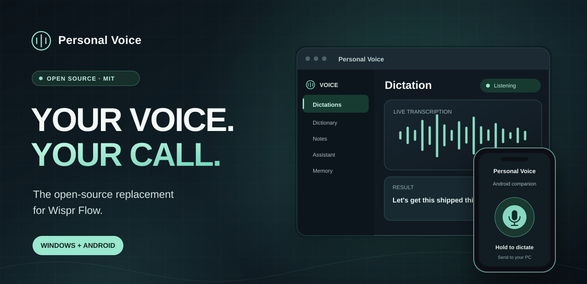
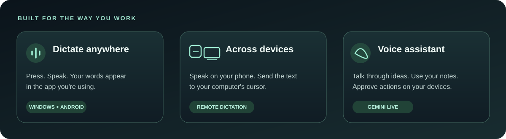

  

<h1 align="center">Personal Voice</h1>

  <strong>The open-source replacement for Wispr Flow.</strong> 
  Dictate anywhere. Own your workflow. Windows + Android.

  
  
  
  

  <a href="https://github.com/Danejw/personal-voice/releases/latest"><strong>Download Personal Voice</strong></a>
  &nbsp;&middot;&nbsp;
  <a href="#what-you-can-do">Features</a>
  &nbsp;&middot;&nbsp;
  <a href="#your-data-your-decision">Privacy</a>
  &nbsp;&middot;&nbsp;
  <a href="docs/OPEN_SOURCE.md">Self-hosting</a>
  &nbsp;&middot;&nbsp;
  <a href="CONTRIBUTING.md">Contribute</a>

  

---

## Your voice is personal. Your dictation app should be too.

Emails. Messages. Code. Notes. Half-formed ideas. When you start talking to every app, your dictation tool gets a front-row seat to your life.

I built Personal Voice because I wanted more control over that. It replaced Wispr Flow in my own workflow. Now the code is open so you can make it yours.

**Your voice. Your words. Your call.**

## What you can do

| | |
| --- | --- |
| **Dictate into your apps** | Hold a shortcut, speak, and put the finished text where your cursor is. Use a floating mic on Windows or Android. |
| **Talk on one device, type on another** | Send dictation from your phone to your computer, or between your signed-in devices. |
| **Pair devices (preview)** | Pair a Windows computer and an Android phone with a QR or temporary code and approve on the computer. Pairing does not enable remote control. |
| **Nearby device explorer and controls (Android preview)** | Scan the current private Wi-Fi subnet and Bluetooth, group network advertisements by observed IP, and inspect device-reported identity and supported capabilities. Explicit device actions include opening a reachable local web page, supported UPnP playback/volume, and Samsung Tizen remote pairing through encrypted WSS with TV approval and certificate pinning. Only authorized Personal Voice PCs can open Companion. |
| **DeviceLink (in development)** | A signed, encrypted local device connection with cloud wake-up fallback. Existing remote dictation and computer-action acknowledgments remain authoritative. |
| **Android Companion (preview)** | Place your phone beneath a monitor, choose one paired PC, and see the animated eyes follow its pointer over local Wi-Fi. Press and hold the animated character to speak, then release to let the existing Assistant respond. No separate voice button. A preview task card shows signed Computer Use receipts and allows Update / Stop; Android task history is not yet durable. |
| **Remote voice actions (preview)** | Ask your phone's Assistant to act on one selected paired PC. When Allow remote actions is enabled on the unlocked Windows PC, paired Android commands execute without approving each click. |
| **Visual desktop control (PR42 preview)** | On Windows, supervised pointer commands move the real mouse with a branded, click-through PV cursor, including clicks, right-clicks and bounded drags. Paired Android devices can request explicitly approved actions through signed DeviceLink requests after the SQL migration is applied. Physical-device validation is pending. |
| **Remote Computer Use goals (PR45 draft)** | From Android, request one whole desktop goal on a paired Windows PC. After one PC approval, the existing Computer Use loop works through multiple screenshot-guided steps; use the same signed device connection to ask status or stop. Preview only: Windows app process must stay running; goal edits, persistence and resume are not included. [Review contract](docs/device-link-plans/07-remote-computer-goals.md). |
| **Make it sound like you** | Save words in your dictionary, expand snippets, and apply text transforms. |
| **Keep your notes close** | Save notes, attach files, capture selections, and pick up where you left off. |
| **Use a real voice assistant** | Have a live Gemini conversation. With your permission, the assistant can use notes, memory, screen context, and supported device controls. |
| **See your own patterns** | Review dictation activity, assistant usage, insights, and connected devices. |

Personal Voice runs on **Windows and Android**. The two share account features, while some screen and computer controls are Windows-specific.

## Get Personal Voice

Download the latest release for your device:

| Windows | Android |
| :--- | :--- |
| [**Download Windows installer**](https://github.com/Danejw/personal-voice/releases/latest) | [**Download Android APK**](https://github.com/Danejw/personal-voice/releases/latest) |
| Windows installer and in-app updates | APK installation and release updates |

Install the app, sign in, grant the microphone and device permissions you want to use, and set your preferred dictation shortcut or floating microphone.

**Before you install:** Published builds connect to the project's configured cloud backend. They use Google Gemini for live voice processing and require a signed-in account. Review [how your data is handled](#your-data-your-decision) and the [release notes](https://github.com/Danejw/personal-voice/releases/latest).

## Your data. Your decision.

A dictation app can see the words you send into almost everything you use. You should know where that data goes.

- **Live audio:** Sent directly to Google Gemini while a voice session is active. Personal Voice does not operate its own audio-recording warehouse.
- **Device pairing (preview):** Temporary pairing invitations and public verification keys are stored with your account. Non-exportable private signing keys remain in Android Keystore or the Windows CNG per-user key store; privileged pairing operations verify native-device signatures on the server. Real-device validation is still required before release.
- **Remote voice (preview):** Android can choose a specific paired Windows PC as the default voice-action target. Remote requests, action arguments and PC outcomes are cryptographically bound to the paired device identities and expire. A queued request is not a success until the selected computer returns a signed result. Enable Allow remote actions on Windows once to authorize bounded mouse, app, text and computer-goal commands from cryptographically paired devices without per-command prompts. Locked desktops and revoked pairing block further actions; high-risk Computer Use steps still require approval. Remote automatic execution requires its matching backend migration and Edge Function.
- **Android Companion (preview):** Open Companion in Android after pairing. Select a specific PC if more than one is paired. A phone cannot subscribe to multiple PCs' cursor feeds simultaneously or switch to another PC silently. Monitor placement supports mixed-size displays. Windows only samples cursor coordinates and monitor bounds while the phone view is visible and actively requesting them over encrypted local Wi-Fi; exiting, backgrounding, disconnecting or revoking pairing stops updates. No screen pixels, window titles, pointer history or cursor data are sent to the cloud. Companion gates microphone audio to character holds and signals end of each burst without ending the Live session. Physical-device acceptance is still pending.
- **Nearby scan (Android preview):** User-triggered discovery checks a bounded part of the connected private Wi-Fi subnet using short TCP connections on a fixed set of common ports, and separately discovers advertised network services, BLE devices, discoverable Bluetooth Classic devices and bonded Bluetooth accessories. Android Nearby Devices and local-network permissions apply. Discovery data and manually placed positions remain local. No router credentials, MAC addresses in the interface, physical location estimates, background scans or automated pairing. Selected devices can be inspected through bounded same-host UPnP descriptions, and only verified supported actions become available; explicit Samsung Tizen remote pairing requires the TV on-screen approval and pinned TLS fingerprint. No arbitrary device control. This is not an exhaustive inventory: sleeping, firewalled, isolated or non-advertising devices may not appear. See [scanner scope](docs/device-link-plans/10-full-network-device-explorer.md) and [capability safety / testing](docs/device-link-plans/11-local-device-capabilities.md).
- **DeviceLink (in development):** Local Wi-Fi discovery shares only a device ID and port. Signed ephemeral handshakes derive AES-GCM session keys, and cloud signals contain only a request ID and request category. The app does not relay audio, transcripts, screenshots, or cursor streams through cloud signaling. Android 17 requires permission for local network discovery. LAN discovery currently uses bounded UDP broadcasts; mDNS/NSD support and real-device connectivity tests remain pending.
- **Dictation history:** Uploading recent dictation text is a separate opt-in setting. Saved notes and assistant conversations can sync with your account.
- **Your own deployment:** The app, Supabase migrations, and Edge Functions are in this repository. You can use a backend you control and configure your own Gemini credentials.

**A clear boundary:** Personal Voice currently uses cloud-based Gemini models. It is not an offline transcription app. Running your own backend gives you control over the application storage and infrastructure, but live audio still goes to Google for processing. API usage and hosting may cost money.

Read the [privacy and architecture details](docs/DEVELOPER_GUIDE.md#privacy-and-safety) or the [independent deployment guide](docs/OPEN_SOURCE.md).

## Open source, built to be yours

Personal Voice is built with **Tauri 2, Rust, React, TypeScript, and Android Kotlin**, with **Supabase** for account-backed features and **Google Gemini Live** for dictation and assistant sessions.

Want to run your own version, work on a feature, or understand the internals?

| Resource | Start here |
| --- | --- |
| Run your own backend | [Open-source setup and deployment](docs/OPEN_SOURCE.md) |
| Explore the implementation | [Technical guide](docs/DEVELOPER_GUIDE.md) and [architecture](docs/ARCHITECTURE.md) |
| Build on Windows or Android | [Windows guide](docs/WINDOWS.md) and [Android guide](docs/ANDROID.md) |
| Learn about the assistant tools | [Assistant implementation](docs/Assistant-Phases/README.md) |
| Ship a release | [Release guide](docs/RELEASING.md) and [DeviceLink acceptance](docs/device-link-plans/06-acceptance.md) |
| Make a contribution | [Contributing guide](CONTRIBUTING.md) |

The full documentation covers the tool harness, permissions, testing, migrations, and platform-specific behavior. Start with the [technical guide](docs/DEVELOPER_GUIDE.md) for the detailed feature breakdown and development commands.

## Contributing

Bug reports, ideas, and pull requests are welcome. Read [CONTRIBUTING.md](CONTRIBUTING.md) before making changes, especially to the assistant's tool and permission system.

## License

Personal Voice is licensed under the [MIT License](LICENSE). Third-party dependencies retain their own licenses.

Personal Voice is an independent project and is not affiliated with or endorsed by Wispr Inc. **Wispr Flow** is referenced only to explain the product it replaced for its creator.
